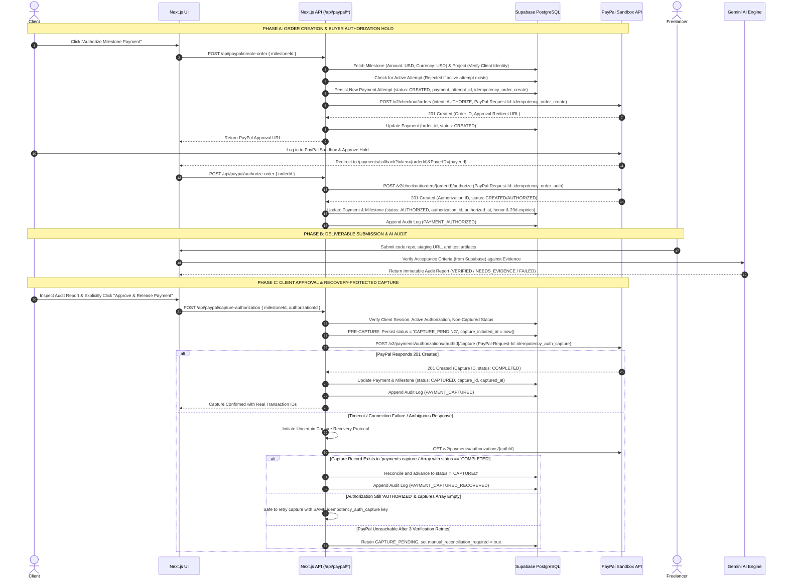

# MILESTONE AI — Phase 6.3: Final PayPal Implementation Plan

**Author**: Antigravity AI Engineering & Security Team  
**Date**: November 8, 2026  
**Status**: FINAL PLAN AWAITING HUMAN APPROVAL (No payment execution code or migration run)  
**Target Environment**: PayPal Sandbox (`https://api-m.sandbox.paypal.com`)  
**Companion Migration**: [`supabase/migrations/20261108030000_paypal_payments_hardening.sql`](file:///c:/Users/moham/Desktop/milestone-ai/supabase/migrations/20261108030000_paypal_payments_hardening.sql)  
**Database Plan**: [`PAYPAL_DATABASE_MIGRATION_PLAN.md`](file:///c:/Users/moham/Desktop/milestone-ai/PAYPAL_DATABASE_MIGRATION_PLAN.md)  
**Failure Recovery Plan**: [`PAYPAL_FAILURE_RECOVERY_TEST_PLAN.md`](file:///c:/Users/moham/Desktop/milestone-ai/PAYPAL_FAILURE_RECOVERY_TEST_PLAN.md)  
**Approval Checklist**: [`FINAL_PAYPAL_APPROVAL_CHECKLIST.md`](file:///c:/Users/moham/Desktop/milestone-ai/FINAL_PAYPAL_APPROVAL_CHECKLIST.md)  

---

## 1. Exact PayPal Workflow Sequence

MILESTONE AI executes a 15-step two-phase financial authorization and release pattern:



---

## 2. Payment Recipient Documentation & Visible Demo Limitation

### 2.1 The Actual Payment Recipient
- **Platform Merchant Account**:
  In standard PayPal Orders v2 / Payments v2, the recipient/payee on every PayPal order is the **Platform PayPal Merchant Account** (configured via `PAYPAL_CLIENT_ID` / `PAYPAL_CLIENT_SECRET`).
- **Settlement Destination**:
  When a milestone payment is captured, the funds settle directly into the **Platform Merchant PayPal Account**.

### 2.2 Freelancer Payout Boundary
- Captured funds do **not** automatically route to separate freelancer PayPal accounts in this standard PayPal REST integration.
- Automated secondary disbursal to an external freelancer account requires an approved **PayPal Commerce Platform for Marketplaces (Multiparty)** or **PayPal Payouts API** integration with verified merchant onboarding.
- **Visible Demo Limitation**:
  The application UI and documentation explicitly state:
  > *"Notice: In this PayPal Sandbox demonstration, milestone funds are authorized and captured into the Platform Merchant Account. Automated secondary disbursal to individual freelancer accounts requires PayPal Marketplace / Partner onboarding."*

---

## 3. Discrete Payment Attempts & Stable Idempotency

### 3.1 Unique Payment-Attempt ID
- Each payment attempt is assigned a globally unique `payment_attempt_id` (e.g. `att_9f8e7d...`).
- An integer `attempt_number` increments per milestone (`1, 2, 3...`).
- Historical payment records (`VOIDED`, `FAILED`, `EXPIRED`) remain intact in PostgreSQL.
- Database index `uq_active_milestone_payment_attempt` guarantees that only ONE attempt per milestone can be in `CREATED`, `APPROVED`, `AUTHORIZED`, or `CAPTURE_PENDING`.

### 3.2 Operation-Specific Idempotency Keys
Idempotency keys are deterministically seeded from the `payment_attempt_id`:
- `idempotency_order_create` = `ord_create_${payment_attempt_id}`
- `idempotency_order_auth` = `ord_auth_${payment_attempt_id}`
- `idempotency_auth_capture` = `auth_cap_${payment_attempt_id}`
- `idempotency_refund` = `refund_${payment_attempt_id}`

**Retry Rule**: Retries of the *same* operation on the *same* attempt reuse these exact keys. If an attempt is voided or fails, a *new* legitimate payment attempt receives a new `payment_attempt_id` and fresh idempotency keys.

---

## 4. Strengthened Uncertain Capture Recovery Protocol

```
[Client Clicks Release]
        │
        ▼
[Persist CAPTURE_PENDING in DB] (Before outbound network call)
        │
        ▼
[POST /v2/payments/authorizations/{id}/capture] (with PayPal-Request-Id: idempotency_auth_capture)
        │
        ├─── HTTP 201 COMPLETED ────────────► [Mark CAPTURED in DB & Milestones]
        │
        └─── Timeout / Connection Error / 5xx
                     │
                     ▼
        [DO NOT ASSUME FAILURE]
        [DO NOT CREATE SECOND CHARGE]
        [DO NOT RETRY SOLELY BECAUSE AUTHORIZATION IS 'AUTHORIZED']
                     │
                     ▼
        [Execute Recovery: GET /v2/payments/authorizations/{id}]
                     │
                     ├─── Capture Exists in 'payments.captures' Array with COMPLETED
                     │       └─► Fetch Capture ID & Reconcile DB to 'CAPTURED'
                     │
                     ├─── Captures Array is Empty AND Status is 'AUTHORIZED'
                     │       └─► Safe to Retry Capture with SAME idempotency_auth_capture key
                     │
                     ├─── PayPal Status is 'VOIDED' or 'EXPIRED'
                     │       └─► Advance DB to 'VOIDED' or 'EXPIRED'
                     │
                     └─── Unreachable After 3 Tries
                             └─► Retain 'CAPTURE_PENDING'
                             └─► Set manual_reconciliation_required = true
                             └─► Flag in audit_logs for Administrator Review
```

---

## 5. Authorization Expiry & Honor Period Handling

- `authorized_at`: Exact timestamp when buyer authorization was captured.
- `honor_period_expires_at`: `authorized_at + interval '3 days'`. PayPal recommends capturing within 3 business days for highest capture success; during this window funds are held on reserve.
- `authorization_expires_at`: `authorized_at + interval '29 days'`. Authorizations remain valid for capture through Day 29.
- **Never Auto-Expire on Day Four**: Authorizations remain in status `AUTHORIZED` through Day 29. They are never prematurely expired on Day 4. Expiry is only marked if 29 days elapse without capture or if PayPal explicitly returns HTTP 422 `AUTHORIZATION_EXPIRED`.

---

## 6. Financial & Currency Integrity Controls: USD Only

1. **Server-Authoritative Pricing**:
   - `amount` and `currency` are fetched exclusively from `public.milestones` in Supabase.
   - Client-provided amounts in request bodies are completely ignored.
2. **Currency Standardization (USD Only)**:
   - Initial MVP is strictly restricted to **USD (`USD`)** on both `public.payments` and `public.milestones`.
3. **Amount Precision**:
   - Stored as `numeric(12,2)`. Formatted to exact 2 decimal places (`amount.toFixed(2)`).
4. **No Partial Captures**:
   - MILESTONE AI enforces 100% full milestone amount captures to ensure contractual milestone funding.
5. **Webhook Deduplication**:
   - Webhooks are recorded in `public.paypal_webhook_events(transmission_id)`.
   - Repeated deliveries of the same `PAYPAL-TRANSMISSION-ID` return HTTP 200 without duplicate processing.

---

## 7. Implementation Stages (Awaiting Human Approval)

- [x] **Stage 0**: Schema audit, failure recovery protocol, migration script `20261108030000_paypal_payments_hardening.sql`, and `FINAL_PAYPAL_APPROVAL_CHECKLIST.md`.
- [ ] **Stage 1**: User reviews and applies database migration in Supabase SQL Editor.
- [ ] **Stage 2**: Implement server-side PayPal REST client (`src/lib/paypal/*`) with OAuth2 caching, idempotency headers, and recovery helpers.
- [ ] **Stage 3**: Implement API route handlers (`create-order`, `authorize-order`, `capture-authorization`, `webhook`).
- [ ] **Stage 4**: Implement UI state integration in `PaymentsPage`, `TransactionsPage`, and `VerificationPage`.
- [ ] **Stage 5**: Execute live Sandbox tests against `PAYPAL_FAILURE_RECOVERY_TEST_PLAN.md` and generate `PAYPAL_TEST_REPORT.md` and `PAYPAL_SETUP.md`.
