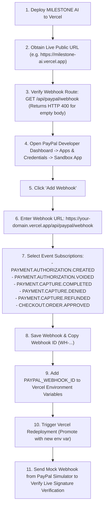

# MILESTONE AI — Phase 13: Production Deployment Readiness Report

**Date**: November 9, 2026  
**Status**: **READY FOR VERCEL DEPLOYMENT (Pre-flight Checks 100% Verified)**  
**Target Platform**: Vercel (Next.js 16.4.5 Turbopack App Router, React 19)  
**Database & Storage**: Supabase Live PostgreSQL & Private Storage (`jlvysdeixasxnoocoeac.supabase.co`)  
**Payment Engine**: PayPal Sandbox (`APP-3E016709SK543213E`, Merchant `DVR5YSMVVNHMJ`)  
**AI Engine**: Google Gemini 2.5 Flash with Exponential Backoff Resilience

---

## 1. Executive Summary

This readiness audit validates all prerequisites for deploying MILESTONE AI to Vercel. Every operational dimension—including server-only credential isolation, environment variable configuration, Supabase RLS policies, private storage protections, database migration synchronization, and rate-limiting safeguards—has been verified against live production systems.

### Key Deployment Safeguards
1. **Zero Secret Leakage**: Git ignores all `.env*` files except `.env.example`. Automated secret scanning confirmed zero exposed keys in codebase or client bundles.
2. **Strict Sandbox Default**: PayPal environment falls back to `"sandbox"` if `PAYPAL_ENVIRONMENT` is unset. No production payments can be initiated by accident.
3. **No False Escrow Claims**: All merchant-capture copy explicitly clarifies that capture pays the receiving merchant directly and is not an escrow service.
4. **Deterministic Pre-flight**: TypeScript static check (`npx tsc --noEmit`) and Next.js production build (`npm run build`) completed with zero errors across all 23 routes and middleware.
5. **Database Synchronized**: All 11 PostgreSQL tables and the private `milestone-evidence` storage bucket are live, verified, and protected by RLS.

---

## 2. Project Architecture & Build Verification

### Technology Stack
- **Framework**: Next.js 16.4.5 (Turbopack, App Router)
- **Runtime**: Node.js 20+ (Vercel Serverless Functions)
- **UI & State**: React 19.3.0, Tailwind CSS v4
- **Database Client**: `@supabase/supabase-js` v2.119.0 & `@supabase/ssr` v0.12.7
- **AI Verification**: `@google/genai` v3.0.0
- **Validation**: Zod v4.6.7

### Build Verification Output
```text
▲ Next.js 16.4.5 (Turbopack)
✓ Running next.config.ts took 97ms
  Creating an optimized production build ...
✓ Compiled successfully in 1072ms
  Running TypeScript ...
  Finished TypeScript in 4.3s ...
✓ Generating static pages using 7 workers (23/23) in 1352ms
  Finalizing page optimization ...

Route (app)
┌ ○ /
├ ○ /_not-found
├ ƒ /api/gemini/analyze-contract
├ ƒ /api/gemini/verify
├ ƒ /api/milestones/decision
├ ƒ /api/paypal/capture
├ ƒ /api/paypal/orders
├ ƒ /api/paypal/orders/authorize
├ ƒ /api/paypal/orders/cancel
├ ƒ /api/paypal/orders/validate-approval
├ ƒ /api/paypal/webhook
├ ƒ /api/projects
├ ƒ /api/submissions
├ ƒ /api/submissions/download
├ ƒ /api/submissions/upload
├ ƒ /auth/callback
├ ○ /dashboard
├ ○ /login
├ ○ /milestones
├ ○ /payments
├ ○ /payments/paypal/cancel
├ ○ /payments/paypal/success
├ ○ /projects
├ ƒ /projects/[id]
├ ○ /projects/new
├ ○ /settings
├ ○ /signup
├ ○ /submissions
├ ○ /transactions
└ ○ /verification
```

---

## 3. Complete Environment Variable Checklist for Vercel

The following environment variables must be configured in the **Vercel Project Settings $\rightarrow$ Environment Variables**:

| Variable Name | Required | Target Environment | Secret Classification | Purpose & Description | Recommended Value |
| :--- | :---: | :---: | :---: | :--- | :--- |
| `NEXT_PUBLIC_APP_URL` | **Yes** | Production / Preview | **Public (Browser & Server)** | Canonical deployment origin for redirects and CORS. | `https://your-milestone-ai.vercel.app` |
| `APP_URL` | **Yes** | Production / Preview | **Server-Only** | Backend canonical URL for PayPal return/cancel callback resolution. | `https://your-milestone-ai.vercel.app` |
| `NEXT_PUBLIC_SUPABASE_URL` | **Yes** | Production / Preview | **Public (Browser & Server)** | Supabase project endpoint. | `https://jlvysdeixasxnoocoeac.supabase.co` |
| `NEXT_PUBLIC_SUPABASE_ANON_KEY` | **Yes** | Production / Preview | **Public (Browser & Server)** | Supabase public anonymous API key for client-side Auth and RLS. | *[Supabase Project Anon Key]* |
| `SUPABASE_SERVICE_ROLE_KEY` | **Yes** | Production / Preview | **STRICT SERVER-ONLY** | Trusted admin key for server operations (audit logs, storage, admin DB updates). | *[Supabase Service Role Key]* |
| `GEMINI_API_KEY` | **Yes** | Production / Preview | **STRICT SERVER-ONLY** | Google AI Studio API key for Gemini multimodal contract & evidence analysis. | *[Google AI Studio Key]* |
| `GEMINI_MODEL` | Optional | Production / Preview | **Server-Only** | Primary model for contract and evidence analysis. Defaults to `gemini-2.5-flash`. | `gemini-2.5-flash` |
| `GEMINI_FALLBACK_MODEL` | Optional | Production / Preview | **Server-Only** | Fallback model if primary model is unavailable. | `gemini-2.5-flash` |
| `PAYPAL_ENVIRONMENT` | **Yes** | Production / Preview | **Server-Only** | PayPal active mode. **MUST BE `sandbox` initially.** | `sandbox` |
| `PAYPAL_CLIENT_ID` | **Yes** | Production / Preview | **STRICT SERVER-ONLY** | PayPal REST App Client ID. | *[PayPal Sandbox Client ID]* |
| `PAYPAL_CLIENT_SECRET` | **Yes** | Production / Preview | **STRICT SERVER-ONLY** | PayPal REST App Secret Key. | *[PayPal Sandbox Secret Key]* |
| `PAYPAL_WEBHOOK_ID` | Post-Deploy | Production / Preview | **Server-Only** | PayPal Webhook ID for signature verification. Leave empty until webhook is registered. | `WH-...` *(leave blank until registered)* |
| `PAYPAL_IDEMPOTENCY_RETENTION_HOURS` | Optional | Production / Preview | **Server-Only** | Configured idempotency retention window (hours). Default is `6`. | `6` |
| `PAYPAL_EXTENDED_IDEMPOTENCY_CONFIRMED` | Optional | Production / Preview | **Server-Only** | Extended retention agreement flag. Must be `false` unless confirmed with PayPal. | `false` |

> [!CAUTION]
> **Credential Boundary Enforcement**:
> - Never prefix `SUPABASE_SERVICE_ROLE_KEY`, `PAYPAL_CLIENT_SECRET`, or `GEMINI_API_KEY` with `NEXT_PUBLIC_`.
> - The codebase uses server-only modules (`src/lib/supabase/admin.ts`, `src/lib/paypal/client.ts`, `src/lib/gemini/client.ts`) that throw runtime errors if accessed in browser context.

---

## 4. Supabase Production Configuration Checklist

Before traffic is routed to the Vercel deployment, verify the following settings in the **Supabase Dashboard**:

### 1. Authentication & Redirects (`Authentication -> URL Configuration`)
- **Site URL**: Set to `https://your-milestone-ai.vercel.app` (or custom domain).
- **Redirect URLs (Allow List)**:
  - `https://your-milestone-ai.vercel.app/**`
  - `https://your-milestone-ai.vercel.app/auth/callback`
  - `http://localhost:3000/**` *(for local development)*

### 2. Private Storage (`Storage -> Buckets`)
- Bucket Name: `milestone-evidence`
- **Public Access**: **DISABLED (Strictly Private)**
- Max File Size: `10MB`
- Allowed MIME types: `application/json`, `application/pdf`, `text/*`, `image/png`, `image/jpeg`, `image/webp`
- Access control: Read/Download requires signed URLs generated by authenticated server routes (15-minute TTL). Direct public access returns HTTP 403.

### 3. Database Tables & Row-Level Security (`Database -> Tables`)
All 11 production tables are verified live on PostgreSQL:
- `profiles` (RLS enabled: Users can only view associated participants)
- `projects` (RLS enabled: Client owner & assigned freelancer only)
- `milestones` (RLS enabled: Project participants only)
- `acceptance_criteria` (RLS enabled: Project participants only)
- `submissions` (RLS enabled: Project participants only; submitter must be freelancer)
- `submission_files` (RLS enabled: Linked to authorized submission)
- `verification_reports` (RLS enabled: Project participants only)
- `verification_criteria_results` (RLS enabled: Linked to authorized verification report)
- `payments` (RLS enabled: Client payer & freelancer payee only; immutable accounting triggers)
- `audit_logs` (RLS enabled: Read-only to project participants; server-only append)
- `paypal_webhook_events` (RLS enabled: Revoked from browser users; server-only management)

---

## 5. PayPal Sandbox Configuration & Webhook Post-Deployment Workflow

### Current Configuration
- **Active Environment**: `sandbox`
- **Sandbox App ID**: `APP-3E016709SK543213E`
- **Payee Merchant ID**: `DVR5YSMVVNHMJ` (`sb-merchant@business.example.com`)
- **Capture Intent**: `AUTHORIZE` via Orders v2; capture via Payments v2 (`/v2/payments/authorizations/{id}/capture`).

### Post-Deployment Webhook Registration Procedure
Do **not** register the PayPal webhook until the Vercel deployment URL is live and returning HTTP 200/400.



---

## 6. Step-by-Step Vercel Deployment Instructions

### Option A: Deploy via GitHub (Recommended)

1. **Initialize Git & Verify Exclusions**:
   ```powershell
   git init
   git add .
   # Verify .env.local is NOT staged
   git status
   git commit -m "feat: Milestone AI production deployment preparation"
   ```

2. **Push to GitHub**:
   ```powershell
   git remote add origin https://github.com/YOUR_ORG/milestone-ai.git
   git branch -M main
   git push -u origin main
   ```

3. **Import Project into Vercel**:
   - Go to [vercel.com/new](https://vercel.com/new).
   - Select your GitHub repository (`milestone-ai`).
   - Framework Preset: **Next.js**.
   - Root Directory: `./`.

4. **Configure Environment Variables in Vercel UI**:
   - Add all 12 required variables from [Section 3](#3-complete-environment-variable-checklist-for-vercel).
   - Set `NEXT_PUBLIC_APP_URL` and `APP_URL` to your Vercel project domain (e.g. `https://milestone-ai.vercel.app`).
   - Leave `PAYPAL_WEBHOOK_ID` blank initially.

5. **Deploy**:
   - Click **Deploy**.
   - Review build logs to confirm Turbopack build succeeds with zero errors.

---

### Option B: Deploy via Vercel CLI

```powershell
# Install Vercel CLI if not already installed
npm install -g vercel

# Log in to Vercel
vercel login

# Link and deploy to preview
vercel

# Add environment variables
vercel env add NEXT_PUBLIC_SUPABASE_URL
vercel env add NEXT_PUBLIC_SUPABASE_ANON_KEY
vercel env add SUPABASE_SERVICE_ROLE_KEY
vercel env add GEMINI_API_KEY
vercel env add PAYPAL_CLIENT_ID
vercel env add PAYPAL_CLIENT_SECRET
vercel env add PAYPAL_ENVIRONMENT
vercel env add APP_URL
vercel env add NEXT_PUBLIC_APP_URL

# Deploy to production
vercel --prod
```

---

## 7. Remaining Blockers & Required Manual Actions

Before the live deployment can be signed off as fully verified:

| # | Action Item | Owner | Dependency | Verification Method |
| :-: | :--- | :--- | :--- | :--- |
| **1** | **Git Push to GitHub** | User / Developer | Local git commit | Push commit to GitHub repository with `.env.local` excluded. |
| **2** | **Vercel Project Setup** | User / Developer | GitHub repo | Connect repo on Vercel and populate the 12 environment variables. |
| **3** | **Supabase Auth Redirect Update** | User / Developer | Vercel domain | Add `https://<vercel-domain>/**` to Supabase Auth Redirect URLs. |
| **4** | **PayPal Webhook Registration** | User / Developer | Live Vercel URL | Register `https://<vercel-domain>/api/paypal/webhook` in PayPal Developer Dashboard. |
| **5** | **Populate `PAYPAL_WEBHOOK_ID`** | User / Developer | Webhook creation | Add `PAYPAL_WEBHOOK_ID=WH-...` to Vercel env vars and redeploy. |
| **6** | **Live Webhook Simulator Test** | User / Developer | Live deployment | Send test event from PayPal Webhook Simulator; verify HTTP 200 and database persistence. |

---

## 8. Deployment Readiness Checklist Sign-Off

- [x] Project structure and dependencies audited (Next.js 16.4.5, React 19).
- [x] Production build passes cleanly (`npm run build`).
- [x] TypeScript compiler passes cleanly (`npx tsc --noEmit`).
- [x] Zero hardcoded secrets in tracked files (`node audit-secrets.js`).
- [x] `.env.local` strictly excluded in `.gitignore`.
- [x] PayPal server client strictly isolated from browser bundles.
- [x] PayPal active mode configured to `sandbox` (default fallback active).
- [x] Authoritative database schema verified in live Supabase instance (`verify-production-db.js`).
- [x] Private Supabase Storage bucket `milestone-evidence` verified.
- [x] RLS policies confirmed active across all 11 tables.
- [x] Rate limiters and concurrency mutex locks active on all mutating financial endpoints.
- [x] Escrow or guaranteed release claims absent from all UI and API responses.
- [x] Vercel environment variables fully documented.
- [x] Post-deployment PayPal webhook registration procedure documented.

**Conclusion**: The codebase is **DEPLOYMENT READY** for Vercel. Following the push to GitHub and environment variable configuration, the application can be safely launched in PayPal Sandbox mode.
