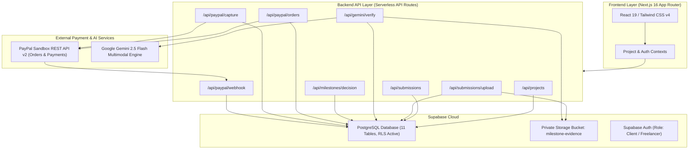

# MILESTONE AI

> **Autonomous Milestone Verification & Gated Payment Authorization Platform**

MILESTONE AI is an enterprise-grade fintech and verification platform that eliminates payment disputes between clients and contractors. By combining deterministic asset validation, multimodal Google Gemini AI evidence audits, and gated PayPal authorization holds, MILESTONE AI guarantees that client funds are only captured when verifiable deliverables meet objective acceptance criteria.

---

## 1. Problem Statement

Traditional freelance and agency contracts suffer from significant financial and operational friction:
- **Subjective Deliverable Reviews**: Clients often struggle to evaluate complex technical deliverables (code quality, test coverage, design token fidelity), leading to protracted review cycles.
- **Payment Insecurity**: Freelancers risk non-payment after investing days or weeks of work, while clients risk paying upfront for unfinished or sub-standard work.
- **Dispute Escalation**: Payment platforms lack objective visibility into whether contractual deliverables were actually completed according to specification.

---

## 2. Solution & Main Differentiator

MILESTONE AI establishes a trustless, transparent verification bridge:
1. **Objective Acceptance Criteria**: Contracts define concrete, measurable criteria (e.g. test coverage $\ge 98\%$, zero high-severity vulnerabilities, design token conformity).
2. **Deterministic & Multimodal AI Verification**: The system combines deterministic file integrity checks (byte fidelity, MIME verification, GitHub/staging reachability) with Google Gemini 2.5 Flash multimodal inspection.
3. **Strict Financial Gating**: Payment authorizations are pre-authorized on PayPal, held without capture, and strictly gated. AI verification is **advisory only**—PayPal capture can **never** be triggered by the AI, and requires an explicit, authenticated client sign-off.
4. **Merchant Capture Model**: All payments use standard PayPal merchant authorization. Pre-authorized funds are captured to the merchant's account upon client approval.

> [!IMPORTANT]
> **Financial & Legal Architecture Notice**:
> Standard PayPal merchant capture requests capture of the existing authorization hold and pays the configured merchant receiving account directly. Standard capture does not automatically disburse funds to the freelancer's wallet or provide an escrow service.

---

## 3. End-to-End Workflows

### Client Workflow
1. **Contract Initialization**: Client creates a project, defines milestones, and establishes measurable acceptance criteria.
2. **PayPal Sandbox Authorization**: Client initiates a PayPal Orders v2 authorization (`intent: AUTHORIZE`). Pre-authorized funds are held against the buyer's account without settlement.
3. **Deliverable Review**: Once deliverables are submitted and audited by Gemini AI, the client receives an interactive audit report with confidence scores and evidence citations.
4. **Explicit Decision**: Client explicitly approves deliverables, requests revisions, or rejects with feedback.
5. **Gated Capture Execution**: Upon client approval, the client confirms payment capture, triggering PayPal Payments v2 capture to the merchant receiving account.

### Freelancer Workflow
1. **Assigned Project Access**: Authenticated freelancer views assigned milestones and required acceptance criteria.
2. **Private Evidence Upload**: Freelancer uploads deliverable artifacts (e.g. test reports, architecture diagrams, build logs) directly to private Supabase Storage (`milestone-evidence`).
3. **Submission Package Creation**: Freelancer packages repository URLs, preview links, notes, and uploaded artifacts into a formal submission.
4. **Inspection Triggering**: Freelancer requests AI verification to benchmark deliverables against acceptance criteria.
5. **Revision Handling**: If revisions are requested by the client, the freelancer updates code and submits secondary evidence.

---

## 4. System Architecture



---

## 5. Technology Stack

- **Framework**: Next.js 16.4.5 (App Router, Turbopack)
- **UI Library**: React 19.3.0
- **Styling**: Tailwind CSS v4, Material Symbols
- **Language**: TypeScript 5 (Strict Mode)
- **Database & Auth**: Supabase PostgreSQL with Row-Level Security (`@supabase/supabase-js`, `@supabase/ssr`)
- **Storage**: Supabase Storage (`milestone-evidence` private bucket with 15-minute signed URLs)
- **AI Engine**: Google Gemini 2.5 Flash via `@google/genai`
- **Payment Processing**: PayPal REST API v2 (Orders v2 & Payments v2)
- **Validation**: Zod v4 Schema Enforcement

---

## 6. Database & Storage Architecture

The application relies on 11 PostgreSQL tables protected by Row-Level Security:

| Table | Purpose | RLS Policy Summary |
| :--- | :--- | :--- |
| `profiles` | User profiles with role flags (`client` / `freelancer`). | Users view own profile and counterparties in shared projects. |
| `projects` | Project scopes, total budgets, and participants. | Participants (client_id or freelancer_id) only. |
| `milestones` | Milestone scopes, status, and payment state machines. | Project participants only. |
| `acceptance_criteria` | Concrete verification criteria per milestone. | Project participants only. |
| `submissions` | Formal milestone deliverable packages. | Project participants only; submitter must be freelancer. |
| `submission_files` | Metadata links to private storage evidence. | Linked to authorized submission. |
| `verification_reports` | Gemini AI audit reports and confidence scores. | Project participants only. |
| `verification_criteria_results` | Audited results per acceptance criterion. | Linked to authorized verification report. |
| `payments` | Immutable payment ledger records. | Payer and payee only. Triggers prevent backward state mutation. |
| `audit_logs` | Append-only event history for all financial actions. | Read-only to participants; server-only insertion. |
| `paypal_webhook_events` | Webhook deduplication and event persistence. | Server-only access; revoked from browser users. |

### Private Storage Configuration
- **Bucket**: `milestone-evidence`
- **Visibility**: **Private** (`public: false`)
- **Path Convention**: `<project_id>/<milestone_id>/<timestamp>_<uuid>_<filename>`
- **Access Protocol**: Time-limited signed URLs (TTL 900 seconds / 15 minutes) generated exclusively via authenticated API routes.

---

## 7. PayPal Sandbox Payment Architecture

MILESTONE AI implements an authorization hold and capture pattern:
1. **Order Creation**:
   - Endpoint: `POST /v2/checkout/orders`
   - Intent: `AUTHORIZE`
   - Payee: Configured Merchant Receiving Account (`DVR5YSMVVNHMJ`)
2. **Buyer Approval**:
   - Buyer redirected to `https://www.sandbox.paypal.com/checkoutnow?token={orderId}`.
   - Server-side pre-flight verification ensures orders cannot be authorized before buyer approval.
3. **Payment Authorization**:
   - Endpoint: `POST /v2/checkout/orders/{order_id}/authorize`
   - Creates an active authorization hold against buyer funds.
4. **Client Approval Gating**:
   - Approval requires completed AI verification report (`VERIFIED`) and explicit client confirmation (`confirmed: true`).
5. **Authorization Capture**:
   - Endpoint: `POST /v2/payments/authorizations/{authorization_id}/capture`
   - Idempotency key reused on retry to guarantee exact-once capture.
   - Status updated to `CAPTURED` in Supabase; payments are never marked `SETTLED` without settlement confirmation.

---

## 8. Installation & Setup

### Prerequisites
- Node.js 20.x or higher
- npm 10.x or higher
- Git

### 1. Clone the Repository
```bash
git clone https://github.com/MohammedAyman07/milestone.git
cd milestone
```

### 2. Install Dependencies
```bash
npm install
```

### 3. Configure Environment Variables
Copy `.env.example` to `.env.local`:
```bash
cp .env.example .env.local
```

Populate the required keys in `.env.local`:
```env
# Application Canonical URL
NEXT_PUBLIC_APP_URL="http://localhost:3000"
APP_URL="http://localhost:3000"

# Google Gemini AI Configuration (Server-Side Only)
GEMINI_API_KEY="your-google-ai-studio-api-key"
GEMINI_MODEL="gemini-2.5-flash"
GEMINI_FALLBACK_MODEL="gemini-2.5-flash"

# Supabase Configuration
NEXT_PUBLIC_SUPABASE_URL="https://your-project.supabase.co"
NEXT_PUBLIC_SUPABASE_ANON_KEY="your-supabase-anon-key"
SUPABASE_SERVICE_ROLE_KEY="your-supabase-service-role-key"

# PayPal Sandbox Configuration
PAYPAL_ENVIRONMENT="sandbox"
PAYPAL_CLIENT_ID="your-paypal-sandbox-client-id"
PAYPAL_CLIENT_SECRET="your-paypal-sandbox-client-secret"
PAYPAL_WEBHOOK_ID="" # Populate after registering webhook

# PayPal Orders v2 Idempotency Retention
PAYPAL_IDEMPOTENCY_RETENTION_HOURS=6
PAYPAL_EXTENDED_IDEMPOTENCY_CONFIRMED=false
```

### 4. Apply Database Migrations
Execute the SQL migrations in order located in `supabase/migrations/`:
1. `20261108000000_milestone_ai_schema.sql`
2. `20261108010000_security_audit_hardening.sql`
3. `20261108020000_milestone_ai_consolidated.sql`
4. `20261108030000_paypal_payments_hardening.sql`

Create the private storage bucket `milestone-evidence` in your Supabase project under Storage.

### 5. Run Development Server
```bash
npm run dev
```
Open [http://localhost:3000](http://localhost:3000) in your browser.

---

## 9. Automated Testing Suite

MILESTONE AI includes comprehensive test suites validating every operational layer:

```bash
# 1. Full End-to-End Sandbox Transaction Lifecycle
node test-phase12-5-full-e2e.js

# 2. Gemini AI Resilience & Backoff Rate-Limiting Tests
node test-phase12-4-gemini-reliability.js

# 3. Private Storage & Evidence Upload Security Tests
node test-phase12-3-evidence-storage.js

# 4. Project & Milestone Creation Integration Tests
node test-phase12-2-project-creation.js

# 5. Client Milestone Approval Workflow Tests
node test-phase10-1-client-approval.js

# 6. Independent PayPal Capture Concurrency & Idempotency Audit
node test-phase10-3-capture-audit.js

# 7. Zero-Secret Repository Audit
node audit-secrets.js

# 8. TypeScript Static Analysis & Production Build
npx tsc --noEmit
npm run build
```

---

## 10. Current Limitations & Scope

1. **PayPal Sandbox Buyer Approval**: PayPal does not provide a public headless API to simulate human buyer authorization. In Sandbox testing, buyer approval requires logging into the PayPal Sandbox prompt at `https://www.sandbox.paypal.com/checkoutnow?token=...`.
2. **Merchant Capture Model**: Captured funds are deposited into the configured merchant receiving account. Freelancer payouts must be administered through merchant accounting and are not automated by this application.
3. **Storage Quota**: File evidence uploads are limited to 10 MB per file to ensure responsive multimodal analysis.

---

## 11. Screenshots

| Overview Dashboard | Deliverable Submission |
| :---: | :---: |
| *[Dashboard Screenshot Placeholder]* | *[Submission Workspace Screenshot Placeholder]* |

| AI Verification Audit | Payment Authorization & Capture |
| :---: | :---: |
| *[AI Verification Review Screenshot Placeholder]* | *[Payment Authorization Screenshot Placeholder]* |

---

## 12. License

This project is licensed under the MIT License.
